# Chapter 3 Supporting Material — MindPulse

**Part 1 — Database Design (derived from the live codebase)**
**Part 2 — Manuscript drafts (Sections 3–7)**

*Generated by static analysis of `supabase/migrations/*.sql`, `mindpulse-web/src`, `mindpulse-mobile/src`, and `mindpulse-backend/`.*

---

# PART 1: DATABASE DESIGN

## 1. Scope of the Physical Data Model

The MindPulse database is a Supabase-hosted PostgreSQL instance whose schema is defined by 29 sequential migration scripts in `supabase/migrations/` (0001–0029). Migration `0001_canonical_schema.sql` establishes the canonical schema and simultaneously quarantines the earlier legacy tables; migrations 0002–0029 incrementally extend it.

### 1.1 Active tables

Fifteen tables constitute the active read/write path of the system. Each was confirmed to be referenced by at least one client (the Android application, the React web dashboard, the Django backend, or a Supabase Edge Function).

| # | Table | Introduced | Extended by | Accessed by |
|---|-------|-----------|-------------|-------------|
| 1 | `profiles` | 0001 | 0012, 0013, 0017, 0028 | Mobile app, Web dashboard |
| 2 | `doctor_profiles` | 0001 | 0006, 0010, 0028 | Mobile app, Web dashboard |
| 3 | `stress_sessions` | 0001 | 0019 | Mobile app (write), Web (read) |
| 4 | `appointments` | 0001 | 0006, 0025 | Mobile app, Web dashboard |
| 5 | `chat_messages` | 0001 | 0007 | Mobile app, Web dashboard |
| 6 | `video_sessions` | 0001 | 0014 | Mobile app, Web dashboard |
| 7 | `notifications` | 0001 | 0014 (Realtime) | Mobile app, Web dashboard |
| 8 | `recommendations` | 0001 | — | Web dashboard (doctor → student) |
| 9 | `assessment_tools` | 0005 | — | Mobile app, Web dashboard (admin CRUD) |
| 10 | `payments` | 0006 | 0023 | Mobile app, Web dashboard |
| 11 | `consultation_notes` | 0014 | 0021, 0025 | Web dashboard (doctor) |
| 12 | `patient_files` | 0016 | — | Mobile app, Web dashboard |
| 13 | `doctor_suggestions` | 0022 | — | Web dashboard (doctor → admin) |
| 14 | `MIND_PLANT_PROGRESS` | 0011 | 0020 | Mobile app (gamification) |
| 15 | `verification_codes` | 0027 | — | `verification-code` Edge Function (service role) |

### 1.2 Objects deliberately excluded from the ERD

| Excluded object | Reason for exclusion |
|---|---|
| `migration_report` | Migration audit log written only by SQL scripts; no application read/write path. |
| `USER`, `STUDENT_PROFILES`, `DOCTOR_PROFILES` (legacy, upper-case), `ASSESSMENT_SESSIONS`, `STRESS_ASSESSMENT_RESULTS`, `SURVEY_RESULTS`, `SURVEY_RESPONSES`, `SURVEY_QUESTION`, `SURVEY_CHOICES`, `HEART_RATE_RECORDS`, `REACTION_TEST_RESULTS`, `FACIAL_ANALYSIS_RESULTS`, `STRESS_HISTORY`, `CONSULTATIONS`, `CONULTATION_REQUESTS`, `CONVERSATIONS`, `MESSAGES`, `NOTIFICATIONS` (legacy), `RECOMMENDATION`, `SESSION_SUGGESTION`, `CONSENT_RECORDS` | Legacy tables quarantined by migration 0001 §13: RLS enabled as deny-by-default and `anon`/`authenticated` privileges revoked. Data preserved for reference only. |
| `GROWTH_LOG`, `GROWTH_STAGE` | Legacy MindPlant gamification tables retained by migration 0001 but no longer queried by any client (the app reads/writes `MIND_PLANT_PROGRESS`). |
| `core_videocallsession` (SQLite, `mindpulse-backend/db.sqlite3`) | Django ORM table used only by the optional local video-session API; not part of the Supabase schema. |
| Supabase `storage.buckets` / `storage.objects` (buckets `chat-attachments`, `profile-photos`, `patient-files`, `consultation-docs`) | File-storage objects governed by storage RLS policies, not relational entities. |

> **Note on foreign keys.** Every user-owning column is physically declared as `references auth.users (id)`. Because `public.profiles.id` itself references `auth.users(id)` with `on delete cascade`, the two are strictly one-to-one. For readability, the ERD below resolves all such references onto `profiles`, which is the application-level user entity.

---

## 1.3 Entity Relationship Diagram (Mermaid.js)

```mermaid
erDiagram
    profiles ||--o| doctor_profiles : owns
    profiles ||--o{ stress_sessions : completes
    profiles ||--o{ appointments : patient_of
    profiles ||--o{ appointments : doctor_for
    profiles ||--o{ chat_messages : patient_side
    profiles ||--o{ chat_messages : clinician_side
    profiles ||--o{ video_sessions : patient_side
    profiles ||--o{ video_sessions : doctor_side
    profiles ||--o{ notifications : receives
    profiles ||--o{ recommendations : student_side
    profiles ||--o{ recommendations : doctor_side
    profiles ||--o{ assessment_tools : authors
    profiles ||--o{ payments : payer
    profiles ||--o{ consultation_notes : patient_side
    profiles ||--o{ consultation_notes : doctor_side
    profiles ||--o{ patient_files : patient_side
    profiles ||--o{ patient_files : doctor_side
    profiles ||--o{ doctor_suggestions : submits
    profiles ||--o{ doctor_suggestions : handles
    profiles ||--o{ verification_codes : subject
    profiles ||--o| MIND_PLANT_PROGRESS : grows
    appointments ||--o{ payments : settled_by
    appointments ||--o| consultation_notes : documented_by
    appointments ||--o{ video_sessions : linked_to

    profiles {
        uuid id PK "FK auth.users(id)"
        text email
        text role "student | doctor | admin"
        text full_name
        text student_no
        text program
        boolean onboarding_complete
    }
    doctor_profiles {
        uuid id PK
        uuid user_id FK "UNIQUE -> profiles.id"
        text specialization
        text license_no
        boolean is_verified
        numeric consultation_fee
    }
    stress_sessions {
        uuid id PK
        uuid user_id FK
        integer score "0-100 fused"
        text stress_level "Low | Moderate | High"
        integer survey_score
        integer heart_rate
        integer reaction_time_ms
        integer face_confidence
        jsonb survey_answers
    }
    appointments {
        uuid id PK
        uuid patient_id FK
        uuid doctor_id FK
        text scheduled_for
        text status
        text consultation_mode "online | in_person"
    }
    chat_messages {
        uuid id PK
        uuid patient_id FK
        uuid clinician_id FK
        text sender "patient | doctor"
        text text
        text attachment_url
        timestamptz read_at
    }
    video_sessions {
        uuid id PK
        uuid patient_id FK
        uuid doctor_id FK
        uuid appointment_id FK "nullable"
        text room_name
        text status
        timestamptz started_at
        timestamptz ended_at
    }
    notifications {
        uuid id PK
        uuid user_id FK
        text title
        text message
        text type "alert | info | appointment"
        boolean read
    }
    recommendations {
        uuid id PK
        uuid student_id FK
        uuid doctor_id FK
        text category
        text priority "Low | Medium | High"
        text note
        text status "Active | Completed"
    }
    assessment_tools {
        uuid id PK
        uuid created_by FK "nullable"
        text title
        text category "Multi-Modal | Supplementary | Brief"
        text status "active | draft | archived"
        jsonb questions
    }
    payments {
        uuid id PK
        uuid appointment_id FK
        uuid patient_id FK
        numeric amount
        text method "card | gcash | maya | cash"
        text reference
        text status "paid | refunded"
    }
    consultation_notes {
        uuid id PK
        uuid appointment_id FK "UNIQUE"
        uuid doctor_id FK
        uuid patient_id FK
        text summary
        boolean shared_with_patient
        text patient_note
    }
    patient_files {
        uuid id PK
        uuid patient_id FK
        uuid doctor_id FK
        text category "prescription | lab_test | other_note"
        text title
        text storage_path
    }
    doctor_suggestions {
        uuid id PK
        uuid doctor_id FK
        uuid handled_by FK "nullable"
        text category
        text priority
        text status "Open | In progress | Resolved"
        text admin_reply
    }
    MIND_PLANT_PROGRESS {
        uuid USER_ID PK "FK -> profiles.id"
        text CURRENT_STAGE
        integer CURRENT_STREAK
        integer TOTAL_GROWTH_POINTS
        integer FREEZES
    }
    verification_codes {
        uuid id PK
        uuid user_id FK
        text channel "email | whatsapp | sms"
        text destination
        text code_hash
        timestamptz expires_at
        integer attempts
    }
```

**Reading the diagram**

* `||--o|` = one-to-zero-or-one (mandatory one parent, optional child); `||--o{` = one-to-many.
* Columns tagged `FK` are the foreign keys; the complete column list for every entity appears in the Data Dictionary below.
* `profiles` is the central user entity: a single account may simultaneously hold a student, doctor, or administrator role (`profiles.role`), which is why several child tables reference it twice (once for each role in the relationship).

---

## 1.4 Data Dictionary

**Legend:** PK = primary key · FK = foreign key · *timestamptz* = timezone-aware timestamp · *jsonb* = JSON document (indexed) · *text[] / date[]* = SQL array.

### Table 1 — `profiles`

Canonical application profile for every signed-in user (students, doctors, administrators). One row per `auth.users` record, created automatically by the `handle_new_user()` sign-up trigger.

| Field Name | Data Type | Constraints | Description |
|---|---|---|---|
| `id` | uuid | PK, FK → `auth.users(id)`, NOT NULL, ON DELETE CASCADE | Mirrors the Supabase Auth user identifier. |
| `first_name` | text | | Given name of the account holder. |
| `last_name` | text | | Family name of the account holder. |
| `middle_name` | text | | Full middle name (0028); the portal renders only the initial. |
| `mi` | text | | Single-letter middle initial (0013), retained for older forms. |
| `full_name` | text | | Concatenated display name used across dashboards. |
| `email` | text | Indexed on `lower(email)` | Registered e-mail address (login identity). |
| `phone` | text | | Mobile number supplied at registration (0012). |
| `role` | text | NOT NULL, DEFAULT `'student'`, CHECK ∈ {student, doctor, admin} | Authorisation role that selects the client workspace; writable only by an administrator. |
| `year_level` | text | | Student's academic year level (e.g., 1st–4th year). |
| `program` | text | | Student's degree program or course. |
| `department` | text | | College or department the student belongs to. |
| `student_no` | text | | Institutional student number. |
| `living_situation` | text | | Dormitory/residence status collected during onboarding (used in contextual risk reading). |
| `birth_date` | date | | Date of birth supplied at registration or health setup. |
| `sex` | text | | Sex/gender recorded for demographic reporting. |
| `mental_conditions` | jsonb | NOT NULL, DEFAULT `'[]'` | Array of self-declared mental health conditions from health setup. |
| `physical_conditions` | jsonb | NOT NULL, DEFAULT `'[]'` | Array of self-declared physical health conditions. |
| `lifestyle_habits` | jsonb | NOT NULL, DEFAULT `'[]'` | Array of self-declared lifestyle habits (sleep, caffeine, smoking, etc.). |
| `none_apply` | boolean | NOT NULL, DEFAULT `false` | True when the respondent declares no health conditions. |
| `onboarding_complete` | boolean | NOT NULL, DEFAULT `false` | Flags completion of first-run health setup. |
| `avatar_url` | text | | Storage path of the user's profile picture (0017). |
| `created_at` | timestamptz | NOT NULL, DEFAULT `now()` | Account creation timestamp. |
| `updated_at` | timestamptz | NOT NULL, DEFAULT `now()` | Last modification timestamp (maintained by trigger). |

*Guardrails:* CHECK on `role`; trigger `profiles_role_guard` prevents self-promotion; trigger `profiles_ensure_doctor_row` auto-creates the matching `doctor_profiles` row when a role becomes `doctor`.

### Table 2 — `doctor_profiles`

One clinical profile per doctor account, holding professional credentials, fees, and availability.

| Field Name | Data Type | Constraints | Description |
|---|---|---|---|
| `id` | uuid | PK, DEFAULT `gen_random_uuid()` | Surrogate key of the clinical profile. |
| `user_id` | uuid | FK → `profiles(id)`, NOT NULL, **UNIQUE**, ON DELETE CASCADE | Links the profile to its owning account (enforces one profile per doctor). |
| `specialization` | text | | Medical specialization of the doctor. |
| `contact_number` | text | | Professional contact number. |
| `license_no` | text | | Professional license number (verified by the administrator). |
| `is_verified` | boolean | NOT NULL, DEFAULT `false` | Administrator approval flag; the dashboard stays locked until `true`. |
| `bio` | text | | Short professional biography shown in the booking directory. |
| `tags` | text[] | NOT NULL, DEFAULT `'{}'` | Search/filter tags for the doctor directory. |
| `availability_notes` | text | | Free-text note describing consultation hours. |
| `consultation_fee` | numeric(10,2) | NOT NULL, DEFAULT `500` | Amount the patient must pay to confirm a booking (0006). |
| `available_slots` | jsonb | NOT NULL, DEFAULT (8 default slots) | Time slots offered to patients in the booking grid (0006). |
| `available_days` | text[] | NOT NULL, DEFAULT all weekdays, CHECK ⊆ {mon…sun} | Weekday keys the doctor accepts bookings on (0010). |
| `blocked_dates` | date[] | NOT NULL, DEFAULT `'{}'` | Specific calendar dates blocked as days off (0010). |
| `title` | text | | Honorific (Dr., Prof., …) used in correspondence (0028). |
| `clinic_address` | text | | Physical clinic address for walk-in patients (0028). |
| `created_at` | timestamptz | NOT NULL, DEFAULT `now()` | Profile creation timestamp. |
| `updated_at` | timestamptz | NOT NULL, DEFAULT `now()` | Last modification timestamp (trigger-maintained). |

### Table 3 — `stress_sessions`

The multimodal assessment record: one row per completed stress assessment, holding every modality input plus the fused score. This is the analytical core of MindPulse.

| Field Name | Data Type | Constraints | Description |
|---|---|---|---|
| `id` | uuid | PK, DEFAULT `gen_random_uuid()` | Unique identifier of the assessment session. |
| `user_id` | uuid | FK → `auth.users(id)`, NOT NULL, ON DELETE CASCADE | Student who completed the assessment. |
| `score` | integer | | Final fused stress score (0–100) computed by weighted multi-modal fusion. |
| `stress_level` | text | CHECK ∈ {Low, Moderate, High} | Categorical band derived from the score (≤35 Low, 36–60 Moderate, >60 High). |
| `heart_rate` | integer | | Manually entered pulse rate in beats per minute (modality 2). |
| `survey_score` | integer | | Raw PSS-10 questionnaire total (modality 1). |
| `survey_answers` | jsonb | | Self-contained snapshot of the questionnaire: `{toolId, toolTitle, items:[{id,text,reverse,value,label}]}` (0019). |
| `emotion` | text | | Dominant facial-emotion label (Happy/Neutral/Sad) retained from earlier flows; nullable. |
| `reaction_time_ms` | integer | | Reaction-time test result in milliseconds (modality 3). |
| `face_confidence` | integer | | Facial-emotion classifier confidence expressed as 0–100 (modality 4). |
| `notes` | text | | Human-readable session summary written by the app at save time. |
| `created_at` | timestamptz | NOT NULL, DEFAULT `now()` | Completion timestamp (drives history, trends, and analytics). |

*Indexes:* `(user_id, created_at DESC)`, `(stress_level)`.
*RLS:* the student may select/insert/update/delete only their own rows; administrators may read and delete all rows.

### Table 4 — `appointments`

Telehealth and walk-in consultation bookings between a student (patient) and a doctor.

| Field Name | Data Type | Constraints | Description |
|---|---|---|---|
| `id` | uuid | PK, DEFAULT `gen_random_uuid()` | Unique booking identifier. |
| `patient_id` | uuid | FK → `auth.users(id)`, NOT NULL, ON DELETE CASCADE | Student who requested the consultation. |
| `doctor_id` | uuid | FK → `auth.users(id)`, NOT NULL, ON DELETE CASCADE | Doctor consulted for the booking. |
| `scheduled_for` | text | NOT NULL | Requested date/time of the consultation (stored as a client-formatted string). |
| `status` | text | NOT NULL, DEFAULT `'scheduled'`, CHECK ∈ {scheduled, awaiting_payment, declined, confirmed, completed, cancelled} | Lifecycle state, enforced by the `enforce_appointment_transition()` trigger (0006). |
| `decline_reason` | text | | Mandatory justification when the doctor declines a booking (0006). |
| `decision_at` | timestamptz | | Timestamp of the doctor's/administrator's approval or decline (0006). |
| `consultation_mode` | text | NOT NULL, DEFAULT `'online'`, CHECK ∈ {online, in_person} | Delivery mode: video consultation or face-to-face at the clinic (0025). |
| `notes` | text | | Reason for visit / booking remarks supplied by the student. |
| `created_at` | timestamptz | NOT NULL, DEFAULT `now()` | Booking creation timestamp. |
| `updated_at` | timestamptz | NOT NULL, DEFAULT `now()` | Last status/timestamp change (trigger-maintained). |

*Indexes:* `(patient_id, created_at DESC)`, `(doctor_id, created_at DESC)`.

### Table 5 — `chat_messages`

Asynchronous student–doctor messaging thread.

| Field Name | Data Type | Constraints | Description |
|---|---|---|---|
| `id` | uuid | PK, DEFAULT `gen_random_uuid()` | Unique message identifier. |
| `patient_id` | uuid | FK → `auth.users(id)`, NOT NULL, ON DELETE CASCADE | Student participant of the thread. |
| `clinician_id` | uuid | FK → `auth.users(id)`, NOT NULL, ON DELETE CASCADE | Doctor participant of the thread. |
| `sender` | text | NOT NULL, CHECK ∈ {patient, doctor} | Direction of the message within the conversation. |
| `text` | text | NOT NULL | Message body. |
| `attachment_url` | text | | Storage path of an attached file, if any (0007). |
| `attachment_name` | text | | Original file name of the attachment (0007). |
| `attachment_kind` | text | CHECK ∈ {image, file} | MIME category of the attachment (0007). |
| `read_at` | timestamptz | | Read-receipt timestamp for the message (0007). |
| `created_at` | timestamptz | NOT NULL, DEFAULT `now()` | Send timestamp. |

*Indexes:* `(patient_id, clinician_id, created_at)`, plus a partial index on unread messages (0007).

### Table 6 — `video_sessions`

A teleconsultation room instance, linked to an appointment and to the Jitsi/Daily meeting room.

| Field Name | Data Type | Constraints | Description |
|---|---|---|---|
| `id` | uuid | PK, DEFAULT `gen_random_uuid()` | Unique video-session identifier. |
| `patient_id` | uuid | FK → `auth.users(id)`, NOT NULL, ON DELETE CASCADE | Student attending the call. |
| `doctor_id` | uuid | FK → `auth.users(id)`, NOT NULL, ON DELETE CASCADE | Doctor hosting the call. |
| `appointment_id` | uuid | FK → `appointments(id)`, ON DELETE SET NULL | Appointment this room belongs to (nullable for ad-hoc sessions). |
| `room_name` | text | NOT NULL, UNIQUE | Conference room identifier used by the video provider. |
| `meeting_url` | text | | Full join URL handed to the in-app call panel. |
| `token` | text | | Short-lived meeting access token. |
| `status` | text | NOT NULL, DEFAULT `'pending'`, CHECK ∈ {pending, active, live, ended, connecting} | Real-time state of the call. |
| `started_at` | timestamptz | | Actual call start time (0014). |
| `ended_at` | timestamptz | | Actual call end time, written by `end_video_consultation()` (0014). |
| `created_at` | timestamptz | NOT NULL, DEFAULT `now()` | Room creation timestamp. |

*Indexes:* `(patient_id, created_at DESC)`, `(doctor_id, created_at DESC)`; published to Supabase Realtime.

### Table 7 — `notifications`

In-app notification feed written directly by the application and by database triggers.

| Field Name | Data Type | Constraints | Description |
|---|---|---|---|
| `id` | uuid | PK, DEFAULT `gen_random_uuid()` | Unique notification identifier. |
| `user_id` | uuid | FK → `auth.users(id)`, NOT NULL, ON DELETE CASCADE | Recipient of the notification. |
| `title` | text | NOT NULL | Short heading shown in the notification bell. |
| `message` | text | NOT NULL | Full notification body. |
| `type` | text | NOT NULL, DEFAULT `'info'`, CHECK ∈ {alert, info, appointment} | Semantic category used for styling and routing. |
| `read` | boolean | NOT NULL, DEFAULT `false` | Read/unread state of the item. |
| `created_at` | timestamptz | NOT NULL, DEFAULT `now()` | Delivery timestamp. |

*Index:* `(user_id, created_at DESC)`; published to Supabase Realtime (0014).

### Table 8 — `recommendations`

Doctor-authored clinical guidance issued to a student (distinct from `doctor_suggestions`, which is a doctor→admin channel).

| Field Name | Data Type | Constraints | Description |
|---|---|---|---|
| `id` | uuid | PK, DEFAULT `gen_random_uuid()` | Unique recommendation identifier. |
| `student_id` | uuid | FK → `auth.users(id)`, NOT NULL, ON DELETE CASCADE | Student recipient of the guidance. |
| `doctor_id` | uuid | FK → `auth.users(id)`, NOT NULL, ON DELETE CASCADE | Doctor who authored the guidance. |
| `category` | text | NOT NULL, DEFAULT `'General'` | Subject area of the recommendation (e.g., sleep, coping, academic load). |
| `priority` | text | NOT NULL, DEFAULT `'Medium'`, CHECK ∈ {Low, Medium, High} | Urgency assigned by the doctor. |
| `note` | text | NOT NULL | Narrative of the recommended action. |
| `status` | text | NOT NULL, DEFAULT `'Active'`, CHECK ∈ {Active, Completed} | Implementation state of the guidance. |
| `created_at` | timestamptz | NOT NULL, DEFAULT `now()` | Creation timestamp. |
| `updated_at` | timestamptz | NOT NULL, DEFAULT `now()` | Last modification timestamp (trigger-maintained). |

*Indexes:* `(student_id, created_at DESC)`, `(doctor_id, created_at DESC)`.

### Table 9 — `assessment_tools`

Admin-managed repository of questionnaires (including the PSS-10) shared by the admin portal and the student assessment hub.

| Field Name | Data Type | Constraints | Description |
|---|---|---|---|
| `id` | uuid | PK, DEFAULT `gen_random_uuid()` | Unique questionnaire identifier. |
| `title` | text | NOT NULL | Display title of the instrument (e.g., *PSS-10 Stress Assessment*). |
| `description` | text | NOT NULL, DEFAULT `''` | Short instruction text shown before the survey. |
| `category` | text | NOT NULL, DEFAULT `'Supplementary'`, CHECK ∈ {Multi-Modal, Supplementary, Brief} | Classification used to group instruments in the hub. |
| `status` | text | NOT NULL, DEFAULT `'active'`, CHECK ∈ {active, draft, archived} | Publication state; only `active` tools are visible to students. |
| `duration_minutes` | integer | NOT NULL, DEFAULT `10`, CHECK BETWEEN 1 AND 240 | Estimated completion time displayed to the student. |
| `questions` | jsonb | NOT NULL, DEFAULT `'[]'` | Ordered array of items `{id, text, pill?, reverse?, options?}`; `reverse` marks reverse-scored PSS-10 items. |
| `created_by` | uuid | FK → `auth.users(id)`, DEFAULT `auth.uid()`, ON DELETE SET NULL | Administrator who authored the tool. |
| `created_at` | timestamptz | NOT NULL, DEFAULT `now()` | Creation timestamp. |
| `updated_at` | timestamptz | NOT NULL, DEFAULT `now()` | Last modification timestamp. |

*Index:* `(status, created_at DESC)`. *RLS:* students read only `active` rows; administrators perform all CRUD.

### Table 10 — `payments`

Mock online payment recorded against a booking (patient-app flow) or a walk-in payment recorded by a doctor.

| Field Name | Data Type | Constraints | Description |
|---|---|---|---|
| `id` | uuid | PK, DEFAULT `gen_random_uuid()` | Unique payment identifier. |
| `appointment_id` | uuid | FK → `appointments(id)`, NOT NULL, ON DELETE CASCADE | Booking being settled. |
| `patient_id` | uuid | FK → `auth.users(id)`, NOT NULL, ON DELETE CASCADE | Student who pays (or on whose behalf the walk-in is recorded). |
| `amount` | numeric(10,2) | NOT NULL, CHECK ≥ 0 | Amount charged, in Philippine pesos. |
| `method` | text | CHECK ∈ {card, gcash, maya, cash} | Payment channel (`cash` reserved for walk-ins, 0023). |
| `reference` | text | NOT NULL | Merchant reference number shown on the receipt (walk-ins receive an `MP-WALKIN-…` reference). |
| `status` | text | NOT NULL, DEFAULT `'paid'`, CHECK ∈ {paid, refunded} | Settlement state of the transaction. |
| `created_at` | timestamptz | NOT NULL, DEFAULT `now()` | Transaction timestamp. |

*Indexes:* `(appointment_id)`, `(patient_id, created_at DESC)`.
*Integrity:* the `appointments_status_guard` trigger blocks `confirmed` unless a paid row exists for the booking.

### Table 11 — `consultation_notes`

Clinical documentation of a completed consultation: the doctor's progress note (private) plus the publishable patient-facing note.

| Field Name | Data Type | Constraints | Description |
|---|---|---|---|
| `id` | uuid | PK, DEFAULT `gen_random_uuid()` | Unique note identifier. |
| `appointment_id` | uuid | FK → `appointments(id)`, NOT NULL, **UNIQUE**, ON DELETE CASCADE | Exactly one note per appointment. |
| `doctor_id` | uuid | FK → `auth.users(id)`, NOT NULL, ON DELETE CASCADE | Authoring psychologist/doctor. |
| `patient_id` | uuid | FK → `auth.users(id)`, NOT NULL, ON DELETE CASCADE | Student the note documents. |
| `summary` | text | NOT NULL | Consultation summary presented to both parties. |
| `observations` | text | NOT NULL, DEFAULT `''` | Initial clinical observations (0014). |
| `recommendation` | text | NOT NULL, DEFAULT `''` | Recommended next steps issued by the doctor. |
| `follow_up` | text | | Follow-up arrangement, if any. |
| `session_date` | text | NOT NULL, DEFAULT `''` | Date the session took place (0021). |
| `session_location` | text | NOT NULL, DEFAULT `'Virtual (Teleconsultation)'` | Venue/mode of the session (0021). |
| `duration_minutes` | integer | | Duration of the session in minutes (0021). |
| `client_name` | text | NOT NULL, DEFAULT `''` | Client name printed on the progress note (0021). |
| `client_dob` | text | NOT NULL, DEFAULT `''` | Client date of birth printed on the note (0021). |
| `psychologist` | text | NOT NULL, DEFAULT `''` | Name and title of the psychologist (0021). |
| `presenting_problem` | text | NOT NULL, DEFAULT `''` | Reason the client sought consultation (0021). |
| `session_content` | text | NOT NULL, DEFAULT `''` | Narrative of what occurred during the session (0021). |
| `interventions` | text | NOT NULL, DEFAULT `''` | Therapeutic interventions applied (0021). |
| `client_response` | text | NOT NULL, DEFAULT `''` | Client's response to the interventions (0021). |
| `therapist_observations` | text | NOT NULL, DEFAULT `''` | Behavioural observations of the therapist (0021). |
| `mental_status_exam` | text | NOT NULL, DEFAULT `''` | Mental status examination findings (0021). |
| `risk_assessment` | text | NOT NULL, DEFAULT `''` | Risk level and safety considerations (0021). |
| `diagnostic_impressions` | text | NOT NULL, DEFAULT `''` | Working diagnostic impressions (0021). |
| `plan_next_session` | text | NOT NULL, DEFAULT `''` | Plan for the next session (0021). |
| `return_to_clinic` | text | NOT NULL, DEFAULT `''` | Recommended return-to-clinic schedule (0021). |
| `shared_with_patient` | boolean | NOT NULL, DEFAULT `false` | Whether the full progress note is visible to the student (0021). |
| `signature` | text | | Digital signature of the doctor (0021). |
| `signed_at` | timestamptz | | Timestamp the note was signed (0021). |
| `attachment_path` | text | | Storage path of a supporting document (0021). |
| `attachment_name` | text | | Original file name of the supporting document (0021). |
| `patient_note` | text | NOT NULL, DEFAULT `''` | Short patient-facing note published instead of the full progress note (0025). |
| `patient_note_published` | boolean | NOT NULL, DEFAULT `false` | Whether the patient note has been released to the student (0025). |
| `created_at` | timestamptz | NOT NULL, DEFAULT `now()` | Note creation timestamp. |
| `updated_at` | timestamptz | NOT NULL, DEFAULT `now()` | Last modification timestamp. |

*Indexes:* `(patient_id, created_at DESC)`, `(doctor_id, created_at DESC)`.
*RLS:* readable by the patient, the doctor, and administrators; writable only by the authoring doctor.

### Table 12 — `patient_files`

Clinical documents uploaded by a doctor against a student case and read by the student in *Profile → My Files*.

| Field Name | Data Type | Constraints | Description |
|---|---|---|---|
| `id` | uuid | PK, DEFAULT `gen_random_uuid()` | Unique document identifier. |
| `patient_id` | uuid | FK → `auth.users(id)`, NOT NULL, ON DELETE CASCADE | Student who owns the document. |
| `doctor_id` | uuid | FK → `auth.users(id)`, NOT NULL, ON DELETE CASCADE | Doctor who uploaded the document. |
| `category` | text | NOT NULL, DEFAULT `'other_note'`, CHECK ∈ {prescription, lab_test, other_note} | Document classification that drives the *My Files* filters. |
| `title` | text | NOT NULL | Display title of the document. |
| `file_name` | text | NOT NULL | Original file name as uploaded. |
| `storage_path` | text | NOT NULL | Path inside the private `patient-files` bucket (`{patient}/{doctor}/{timestamp}_{filename}`). |
| `content_type` | text | | MIME type of the stored object. |
| `size_bytes` | bigint | | File size in bytes. |
| `created_at` | timestamptz | NOT NULL, DEFAULT `now()` | Upload timestamp. |

*Indexes:* `(patient_id, created_at DESC)`, `(doctor_id, created_at DESC)`.

### Table 13 — `doctor_suggestions`

Doctor → administrator communication channel for feature requests, system improvements, and reported issues.

| Field Name | Data Type | Constraints | Description |
|---|---|---|---|
| `id` | uuid | PK, DEFAULT `gen_random_uuid()` | Unique suggestion identifier. |
| `doctor_id` | uuid | FK → `auth.users(id)`, NOT NULL, ON DELETE CASCADE | Doctor who submitted the suggestion. |
| `title` | text | NOT NULL, DEFAULT `''` | Headline of the suggestion. |
| `category` | text | NOT NULL, DEFAULT `'Feature request'`, CHECK ∈ {Feature request, System improvement, Issue or bug, Other} | Type of submission. |
| `priority` | text | NOT NULL, DEFAULT `'Medium'`, CHECK ∈ {Low, Medium, High} | Severity/importance as judged by the doctor. |
| `message` | text | NOT NULL, DEFAULT `''` | Detailed description of the request or issue. |
| `status` | text | NOT NULL, DEFAULT `'Open'`, CHECK ∈ {Open, In progress, Resolved} | Handling state maintained by the administrator. |
| `admin_reply` | text | | Administrator's response to the doctor. |
| `handled_by` | uuid | FK → `auth.users(id)`, ON DELETE SET NULL | Administrator who actioned the suggestion. |
| `created_at` | timestamptz | NOT NULL, DEFAULT `now()` | Submission timestamp. |
| `updated_at` | timestamptz | NOT NULL, DEFAULT `now()` | Last modification timestamp. |

*Indexes:* `(doctor_id, created_at DESC)`, `(status, created_at DESC)`; Realtime-enabled; a trigger raises notifications for admins and for the submitting doctor.

### Table 14 — `MIND_PLANT_PROGRESS`

Gamification state: one MindPlant row per signed-in user, advanced each time a stress session is completed.

| Field Name | Data Type | Constraints | Description |
|---|---|---|---|
| `"USER_ID"` | uuid | PK, FK → `auth.users(id)`, NOT NULL, ON DELETE CASCADE | Owner of the plant (keyed by `auth.uid()`). |
| `"CURRENT_STAGE"` | text | NOT NULL, DEFAULT `'Bare Pot'` | Present growth stage of the study plant. |
| `"CURRENT_STREAK"` | integer | NOT NULL, DEFAULT `0` | Consecutive days on which a session was completed. |
| `"TOTAL_GROWTH_POINTS"` | integer | NOT NULL, DEFAULT `0` | Cumulative growth points earned by the student. |
| `"LAST_SESSION_DATE"` | date | | Date of the most recent session used for streak calculation. |
| `"FREEZES"` | integer | NOT NULL, DEFAULT `2` | Streak freezes available to the student (0020). |
| `"FREEZE_TIER_EARNED"` | integer | NOT NULL, DEFAULT `0` | Number of freeze tiers unlocked (0020). |
| `created_at` | timestamptz | NOT NULL, DEFAULT `now()` | Row creation timestamp. |
| `updated_at` | timestamptz | NOT NULL, DEFAULT `now()` | Last modification timestamp (trigger-maintained). |

*RLS:* the owner (or an administrator) may select; only the owner may insert or update.

### Table 15 — `verification_codes`

Hashed six-digit one-time codes for e-mail, SMS, and WhatsApp sign-in verification. Restricted exclusively to the `verification-code` Edge Function (service role).

| Field Name | Data Type | Constraints | Description |
|---|---|---|---|
| `id` | uuid | PK, DEFAULT `gen_random_uuid()` | Unique code identifier. |
| `user_id` | uuid | FK → `auth.users(id)`, NOT NULL, ON DELETE CASCADE | Account the code was issued for. |
| `channel` | text | NOT NULL, CHECK ∈ {email, whatsapp, sms} | Delivery channel of the code. |
| `destination` | text | NOT NULL | E-mail address or phone number the code was sent to. |
| `code_hash` | text | NOT NULL | Salted/HMAC hash of the six-digit code (never stored in clear text). |
| `expires_at` | timestamptz | NOT NULL | Expiry instant; expired codes are rejected and purged. |
| `consumed_at` | timestamptz | | Set once the code has been successfully used. |
| `attempts` | integer | NOT NULL, DEFAULT `0` | Number of failed verification attempts (brute-force guard). |
| `created_at` | timestamptz | NOT NULL, DEFAULT `now()` | Issue timestamp. |

*Indexes:* `(user_id, channel, destination, created_at DESC)`, `(expires_at)`.
*Privileges:* `REVOKE ALL` from `public`, `anon`, and `authenticated`; granted only to `service_role`.

---

# PART 2: MANUSCRIPT DRAFTS

> **Note on numbering.** The sections below are numbered sequentially within this document (3 through 8) for readability. When integrated into the approved Chapter 3 outline, remap them to the corresponding subsection numbers of the final manuscript.

## 3. Integration Testing

**[Under Testing Phase]**

Integration testing verified that the three independently deployed tiers of MindPulse — the Android mobile application, the Django facial-analysis service, and the Supabase PostgreSQL database — exchange data correctly when a student completes a full multimodal assessment. The test followed the complete happy-path transaction end to end: the application collected the PSS-10 questionnaire, the manually entered heart rate, the reaction-time measurement, and a front-camera facial capture; the facial capture was encoded as a base64 JPEG data URL and transmitted over HTTPS to `POST /api/predict-emotion/`, where the MediaPipe-based landmark extractor and the trained hybrid classifier returned a class label, a probability distribution, and a confidence value within a 20-second client timeout; the four inputs were then normalised onto a common 0–100 stress scale and fused by weighted averaging (survey 50 percent, heart rate 20 percent, facial emotion 20 percent, reaction time 10 percent), with the weights automatically renormalised over whichever modalities were present; and the resulting score was written together with its component values to the `stress_sessions` table through the Supabase client using the authenticated user's JSON Web Token. Testers then read the saved row back from the web clinical dashboard and confirmed that the persisted `score`, `stress_level`, `heart_rate`, `survey_score`, `reaction_time_ms`, `face_confidence`, and `survey_answers` matched the values displayed on the mobile result screen exactly, thereby establishing that no rounding, type coercion, or column-mapping error occurred across the request–response–persistence cycle.

Negative-path and boundary cases were exercised alongside the successful flow to confirm that failures are detected, reported to the user, and never leave the database in a partially written state. Malformed or non-base64 image payloads were required to return HTTP 400 with a descriptive message, a frame containing no detectable face was required to return HTTP 400, and an unavailable inference stack was required to return HTTP 503 rather than a misleading prediction; network loss and server timeouts had to surface as an actionable alert on the device while leaving `stress_sessions` unchanged, so that an immediate retry produced exactly one row. Row-Level Security was validated by asserting that a student could retrieve only their own sessions, that a doctor could view the sessions of assigned students through the clinical dashboard, and that the `verification_codes` table remained invisible to browser and mobile clients. Automated regression coverage supported these manual checks: the Django suite (`python manage.py test core`) exercises the emotion endpoint's parsing, validation, and error-mapping branches with a stubbed model, while the React test suite covers dashboard and notification services; together these confirm that a change in one tier does not silently break the contract consumed by another.

---

## 4. Deployment

**[Under Deployment Phase]**

Deployment was governed by a non-negotiable constraint inherited from the project's circumstances: MindPulse is a student capstone, so no monetary expenditure was permitted for hosting and no provider that requires a credit card could be used. Every tier of the system was therefore placed on infrastructure offered free of charge, and the selection of each host was treated as an engineering decision in its own right — each provider had to accommodate the specific runtime demands of the component it would carry, rather than merely offer storage at zero cost. The resulting topology is summarised in Table 16.

**Table 16 — Deployment topology (zero-cost hosting).**

| Component | Host | Reason for selection | Binding free-tier limit |
|---|---|---|---|
| PostgreSQL database, authentication, realtime, file storage, Edge Functions | **Supabase (Free plan)** | Already provisioned during development; Row-Level Security, role-based policies, and Edge Functions are native to the platform | 500 MB database, 1 GB file storage, 5 GB egress, 50,000 monthly active users; the project pauses after seven days without database activity |
| Clinical and administrative web dashboard (React) | **Vercel (Hobby plan)** | Framework-aware static hosting: the Create React App production build is served over HTTPS with no server process to maintain or patch | Non-commercial use only; 100 GB transfer per month |
| Facial-emotion inference service (Django, TensorFlow, MediaPipe) | **Render (Free web service)** | The only free, credit-card-free platform identified that executes a long-running Python process backed by native numerical libraries | 512 MB RAM, 0.1 vCPU, sleeps after 15 idle minutes, 750 instance-hours per month |
| Android application package | **Expo EAS Build (Free plan)** | Compiles and signs the release APK in the cloud, removing the need for a dedicated build machine or licensed toolchain | 15 Android builds per month, low-priority queue |
| APK distribution to end users | **GitHub Releases** | Permanent, versioned, direct download links without an application-store registration fee | 2 GB per file, far above the size of the APK |

Alternative hosts were evaluated and rejected: serverless platforms (Vercel Functions, Cloudflare Workers, Deno Deploy, Supabase Edge Functions) cannot execute TensorFlow because their package-size and execution-time ceilings exclude the runtime; container platforms that would have suited the inference service (Hugging Face Spaces) now require a paid subscription for newly created Docker spaces on personal accounts; and general-purpose cloud providers (Amazon Web Services, Google Cloud Platform, Oracle Cloud, Railway, and Fly.io) require a payment instrument for account verification. The Google Play Store was likewise excluded because its one-time developer registration fee of USD 25 violates the budget constraint, which made direct APK distribution the necessary approach.

**Deployment sequence.** Because the tiers are interdependent, deployment must proceed in a strict order. **(1) Supabase is verified first:** migrations `0001` through `0029` are applied in the SQL Editor in numerical order (0001 is written as a single transaction, so any failure rolls the whole script back), Row-Level Security and the storage policies are confirmed, the four file-storage buckets are checked, and the first administrator account is promoted with a one-time statement — `update public.profiles set role = 'admin' where email = '…'` — because the schema forbids self-promotion and permits exactly one administrator. This step yields the project URL, the publishable (client-safe) key, and the service-role key. **(2) The inference service is deployed next** by applying the repository's `render.yaml` blueprint (*New → Blueprint*), which installs the Linux CPU/headless dependencies, runs `python manage.py migrate`, starts Gunicorn, and exposes the `/api/health/` health check; `SUPABASE_URL` and `SUPABASE_SERVICE_ROLE_KEY` are set in the service environment — the service-role key is never committed and never shipped to a client — and the resulting HTTPS address is recorded as the value of `EXPO_PUBLIC_MINDPULSE_API_URL`. **(3) The web dashboard is built and published** with `npm install` and `npm run build`, with `REACT_APP_SUPABASE_URL` and `REACT_APP_SUPABASE_PUBLISHABLE_KEY` supplied as build-time environment variables, after which the optimised `build/` folder is imported into Vercel and deployed. **(4) The Android package is built only once the backend address is final**, because `EXPO_PUBLIC_*` variables are inlined into the JavaScript bundle at compile time: `eas build -p android --profile preview` produces a signed release APK that already points at the production inference service. **(5) The APK is uploaded to a GitHub Release** and the permanent download URL is captured for the installation guide. **(6) The installed system is verified** by executing the smoke checklist in Section 5.4.

**Managing free-tier constraints.** Three characteristics of the free plans required deliberate mitigation. First, Render sleeps the inference service after fifteen minutes without traffic and takes up to a minute to wake it, whereas the mobile client previously aborted its request after twenty seconds; the client timeout was therefore raised to ninety seconds so that the first face scan of a session waits for the cold start instead of failing. Second, Render provides only 512 MB of RAM, so the inference stack was slimmed — the CPU-only TensorFlow build replaced the full distribution, an unused plotting dependency was removed from the Linux requirements, Gunicorn runs a single worker with threads rather than multiple worker processes, and TensorFlow's intra-op thread count was capped — because each of these reduces resident memory without altering a single model weight. Third, both Supabase and Render pause inactive resources, so a scheduled GitHub Actions workflow issues a lightweight request on a weekly cycle (Supabase) and a request during pre-arranged demonstration windows (Render), keeping the systems warm while remaining well inside Supabase's seven-day window and Render's 750 instance-hour allowance.

**Graceful degradation.** The deployment design also exploits a property of the scoring algorithm itself: weighted fusion is normalised over whichever modalities are present. If the inference service is unreachable — asleep, offline, or otherwise unavailable — the facial contribution is simply omitted and the survey, heart-rate, and reaction-time weights are renormalised, so an assessment can still be completed and saved. The system therefore degrades to a three-modality assessment rather than failing outright, a behaviour that was confirmed during integration testing and is documented for users in the troubleshooting table of Section 5.3.

---

## 5. Installation Guide

**[Under Deployment Phase]**

Once deployment is complete, installation is separated by role: students install the Android application on their own devices, whereas doctors and administrators require no installation at all and work entirely through a web browser. The guide below is written for the end user rather than the developer.

**5.1 Students — installing the Android application**

*Prerequisites:* an Android 8.0 or newer device with a working front-facing camera, approximately 100 MB of free storage, and an active internet connection.

1. Open the MindPulse download link for the current release (a versioned `.apk` published on the project's GitHub Releases page) in the device's browser or file manager.
2. Download the `MindPulse-v1.0.apk` file.
3. When Android warns that the file may be harmful, choose **Download anyway**. Android blocks packages from outside the Play Store by default, so this warning is expected.
4. Open the downloaded file and, when prompted to allow installations from this source, enable **Install unknown apps** for the browser or file manager. This is a one-time, per-source permission.
5. Tap **Install**, then **Open**.
6. Grant the **Camera** permission when requested. The front camera is used only by the facial-emotion step of the assessment; if it is declined, the remaining steps still function and the assessment is scored from the other modalities.
7. Register an account with a valid e-mail address, confirm the address if e-mail verification is enabled, and complete the health-setup questionnaire.
8. Sign in and run the four-step assessment. The result is stored automatically on save and becomes visible to the student's doctor once a consultation is booked.

**5.2 Doctors and administrators — accessing the clinical dashboard**

1. Navigate to the deployment's dashboard URL in Google Chrome, Microsoft Edge, Firefox, or Safari.
2. Sign in with the account issued by the administrator.
3. The destination is selected automatically from the account's role: approved doctors open the Doctor Dashboard, administrators open the Admin Dashboard, unverified doctor accounts are held at a pending-approval screen, and student accounts are directed to the mobile application.

No installation, plug-in, or browser extension is required; the dashboard is a static web application served over HTTPS and is identical on Windows, macOS, Linux, and ChromeOS.

**5.3 Troubleshooting**

| Symptom | Likely cause | Resolution |
|---|---|---|
| *"Your phone is not allowed to install unknown apps from this source"* | Android's default block on sideloaded packages | Settings → Apps → Special access → Install unknown apps → allow the browser or file manager, then retry the installation |
| *Play Protect flags the package as unrecognized* | The APK does not come from the Play Store | Tap **More details → Install anyway**; the application is the project's own signed build |
| *"Camera access needed"* inside the app | The camera permission was denied at first launch | Settings → MindPulse → Permissions → Camera → Allow; then retry the facial-emotion step |
| *The face scan times out on the first attempt* | The inference service is waking from sleep (free-tier cold start) | Wait up to one minute and tap **Try again**; the other three modalities still produce a valid score in the meantime |
| *Sign-in succeeds but no data appears after a long period of inactivity* | The free database project was paused after seven days without activity | The project owner restores it from the Supabase dashboard (approximately 30 seconds; no data is lost) and the client is reloaded |
| *A doctor account sees only a pending-approval screen* | Doctor accounts start unverified | The administrator approves the account under Manage Users → Doctors |

**5.4 Verification before hand-over.** After installation on a target device, the installer confirms that the inference service reports `{"status":"ok"}` at `/api/health/`, that a test student can register, complete onboarding, and save an assessment that appears in `stress_sessions`, that an approved doctor account can open the dashboard and read that session, that an administrator can manage users and assessment tools, and — using a second test account — that Row-Level Security prevents any user from reading another user's records. Hand-over proceeds only when every item passes.

---

## 6. Road Map

**[Under Deployment Phase]**

The deployment of MindPulse follows a five-phase roadmap in which each phase has explicit entry criteria, activities, and deliverables so that adoption by the partner clinic can be monitored and audited.

**Phase 1 — Preparation and Environment Setup.** Hardware, network, and account requirements are confirmed (Android 8.0+ devices with a front camera, a workstation with Node.js 22+, Python 3.11+, Android Studio, and JDK 17), the Supabase project and hosting accounts are created, secrets are issued and escrowed, and the team is briefed on the release checklist. *Deliverable:* an environment readiness report and a completed infrastructure inventory.

**Phase 2 — System Installation and Migration.** The database migrations are applied in sequence, Row-Level Security and storage policies are verified, the Django backend and the React dashboard are deployed to their production hosts, the Android APK is built and installed on the target devices, and the first administrator, doctor, and test student accounts are provisioned. *Deliverable:* a fully installed three-tier system that passes the post-installation smoke checklist, plus a rollback copy of the database.

**Phase 3 — User Acceptance Testing (UAT).** Representative students, doctors, and administrators execute scripted real-world scenarios (registration and onboarding, completion of a four-modality assessment, booking and payment, video consultation, receipt of recommendations, and administrative user management). Usability is quantified with the **System Usability Scale (SUS)**, in which participants rate ten statements on a five-point Likert scale and the aggregate is converted to a 0–100 score, and with the **Technology Acceptance Model (TAM)**, which measures perceived usefulness and perceived ease of use as the two determinants of behavioural intention to use the system. Defects are logged, severity-classified, and retested; acceptance requires a SUS score at or above the conventional 68-point average, no open critical defects, and TAM means above the neutral point of the scale. *Deliverable:* a UAT summary report with SUS/TAM scores and a signed acceptance record.

**Phase 4 — User Training and Handover.** Role-based training is delivered to each stakeholder group: students are trained on completing an assessment and interpreting their stress band; doctors are trained on reviewing multimodal sessions, writing consultation notes, and issuing recommendations; administrators are trained on user approval, assessment-tool configuration, and report generation. User manuals, quick-reference cards, and the escalation contact list are handed over together with the credentials and source-code repository. *Deliverable:* trained-user roster with attendance, documentation package, and formal turnover certification.

**Phase 5 — Go-Live and Post-Deployment Monitoring.** The system is released for operational use while the team monitors backend health and latency, error and failure rates, database growth, and support tickets. Usage analytics and feedback from the first operational period are reviewed weekly, minor defects are patched continuously, and a post-implementation review is held to decide on further enhancement cycles. *Deliverable:* go-live confirmation, a monitoring log, and a post-implementation review report.

| Phase | Primary objective | Key measure of completion |
|---|---|---|
| 1 — Preparation and Environment Setup | Establish infrastructure and access | Environment readiness report |
| 2 — System Installation and Migration | Install and configure the system | Smoke checklist passed |
| 3 — User Acceptance Testing | Confirm fitness for use and usability | SUS ≥ 68, TAM means > neutral, zero critical defects |
| 4 — User Training and Handover | Transfer knowledge and artefacts | Turnover certification signed |
| 5 — Go-Live and Post-Deployment Monitoring | Operate and improve the system | Monitoring log and post-implementation review |

---

## 7. Conclusion

**[Under Chapter Wrap-up]**

This chapter presented the methodology, testing regime, and deployment plan that guided the development of MindPulse, an AI-assisted emotional stress assessment system for students. The system was realised as a three-tier architecture: an Android mobile application that administers the assessment instruments, a Django inference service that executes the facial-emotion model, and a Supabase backend that provides the PostgreSQL data store, authentication, and Row-Level Security for the React-based clinical dashboard used by doctors and administrators. The physical data model was normalised into fifteen active entities anchored on `profiles` and `stress_sessions`, allowing a single assessment row to carry all four measurement modalities — the PSS-10 survey score, the manually entered heart rate, the reaction-time result, and the facial-emotion prediction — alongside the fused 0–100 stress score and its Low, Moderate, or High classification. Integration testing confirmed that these values traverse the mobile application, the inference API, and the database without loss or corruption, and that failures at any tier are surfaced to the user rather than persisted as incomplete records. Most importantly, the project demonstrates that a reliable, multi-indicator stress assessment can be delivered without the expensive wearable physiological sensors — electrodermal activity monitors, photoplethysmographic wristbands, or clinical-grade heart-rate variability loggers — that traditionally constrain such studies: every input MindPulse requires is already available on an ordinary student smartphone, namely a questionnaire, a manual pulse count, a touch-response test, and the front-facing camera. The dependability of the most technically demanding of these inputs is supported by the hybrid facial classification model, which combines MediaPipe facial landmarks with a learned image representation and attained an accuracy of 73.91 percent on the fused test set (72.83 ± 0.65 percent under five-fold cross-validation), providing a sufficiently strong signal to contribute meaningfully to the weighted fusion. The chapter therefore establishes that the design, verification, and rollout procedures described were adequate to produce a system that is functionally correct, usable, and ready for deployment in a school or clinic setting. Notably, this deployment was achieved entirely through zero-cost infrastructure — a free Supabase database tier, a free static host for the clinical dashboard, a free container instance for the inference service, and direct APK distribution — demonstrating that a functioning, AI-assisted mental-health screening system can be delivered by student developers without any monetary budget.

---

## 8. Recommendations

**[Under Chapter Wrap-up]**

Based on the outcomes and the limitations observed during the development and evaluation of MindPulse, the following directions are recommended for future researchers:

- **Automate heart-rate acquisition through wearable integration.** The current heart-rate modality relies on a manually entered pulse count, which is subject to measurement error and user effort. Future work should integrate Bluetooth Low Energy smartwatches, fitness bands, or chest straps — or a camera-based photoplethysmography estimate derived from the same front-facing frame used for emotion analysis — so that the value is captured continuously and objectively without breaking the system's wearable-free, non-invasive premise.

- **Develop and evaluate an iOS version of the mobile application.** Because MindPulse is presently distributed as an Android APK, the findings are restricted to that platform's user base. Porting the React Native application to iOS (via Xcode and CocoaPods) and validating camera, notification, and background behaviour on Apple devices would extend reach, permit cross-platform comparison of usability scores, and make the system usable in institutions that issue iPhones to students.

- **Expand the training and evaluation dataset beyond the current conditions and population.** The facial classification model should be retrained on images captured under diverse and challenging lighting conditions (backlighting, low light, mixed colour temperature), varied camera quality and angles, and with accessories such as eyeglasses, face masks, and headwear. The sampling frame should also be widened beyond students to include working professionals, out-of-school youth, and clinical or age-diverse respondents, so that the model's 73.91 percent accuracy generalises across skin tones, ages, and cultural groups rather than to the student demographic on which it was calibrated.

- **Replace the single-snapshot facial scan with continuous, on-device affect analysis.** A single captured frame is only a momentary sample of affective state. Future iterations could stream several seconds of video, aggregate frame-level predictions into a more stable emotion estimate, and run inference locally on the device using TensorFlow Lite or MediaPipe so that no facial image ever leaves the student's phone — improving both statistical reliability and data-privacy compliance.

- **Validate and refine the multi-modal fusion model.** The current fusion uses fixed expert-assigned weights (survey 50, heart rate 20, face 20, reaction 10). A follow-up study should collect a clinically labelled dataset and learn these weights — or train an end-to-end fusion model — correlating the system's output against a validated clinical instrument or a licensed practitioner's assessment. Such a study would quantify the system's concurrent validity and could additionally support a longitudinal, population-level view of student stress for institutional counselling offices   .

---

### Writer's notes (not part of the manuscript)

1. **Architecture wording.** Your brief describes a "hybrid MediaPipe + Dense MLP model." The artefacts deployed in `mindpulse-backend/emotion_model/` are documented in `predict_emotion.py` as: MediaPipe FaceLandmarker (478 landmarks → 1,434 normalised coordinates) concatenated with a 64-dimensional CNN pixel embedding → `StandardScaler` → **multinomial logistic regression** head, with class encoder `{0: Happy, 1: Neutral, 2: Sad}`. Confirm which description matches your Chapter 2 before finalising Section 7.
2. **`stress_sessions.emotion` is never written** by the current application (only read); the facial label is conveyed in `notes` and `face_confidence`. The data dictionary above describes it as retained/nullable, which is accurate.
3. **Stale repository notes.** `README.md → Current Limitations` still states that the face scan is a demo that never runs the model. That statement contradicts the shipped code (`FaceScanCameraScreen` → `/api/predict-emotion/` → fusion → `stress_sessions`). Update the README if the panel will read it.
4. **Render free plan.** The README warns the free tier may sleep and may lack memory for TensorFlow + MediaPipe; mention a paid plan as a contingency if deployment reliability is questioned during the defence.
