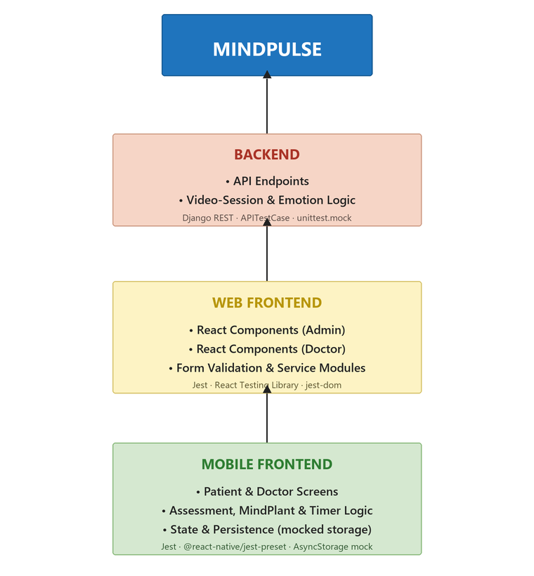

# Testing Phase

## Unit Testing

Unit testing focuses on verifying the functionality of individual components or modules in isolation. In the MindPulse system, this means testing the Django REST API functions independently, the React components and form-validation services used by the administrator and doctor web portals, and the business-logic services behind the patient and doctor screens in the Expo React Native mobile app. External dependencies — Supabase, AsyncStorage, the device clock, and the TensorFlow/MediaPipe emotion model — are replaced with mocks or fixed inputs so that a failing test points to one unit of code rather than to the network, the database, or the model.

For the backend, MindPulse uses Django's built-in test runner and Django REST Framework's `APITestCase`. The test client calls the real URL routes and serializers, while the emotion model is replaced with a mock so that image decoding, status codes, and response mapping can be checked without loading the large inference stack. The video-call endpoints are tested for creation, status updates, duplicate room names, and patient/doctor filtering against an in-memory SQLite test database.

On the web frontend, Jest and React Testing Library render React components in isolation and assert what a user can see and do. The suite covers doctor registration and pending-approval handling, password visibility, profile and security panels, notification filtering, the admin and doctor dashboards, form validation, and the service modules that cache identity and manage sign-in sessions. Supabase calls are mocked, so the tests do not depend on a live project or a stable internet connection.

On the mobile frontend, Jest runs the TypeScript service modules that power the screens: assessment scoring, the MindPlant streak and freeze rules, the wall-clock no-screen pause timer, notification category filtering, remembered-login storage, and assessment completion data. These units are pure or use a mocked AsyncStorage, which keeps the feedback loop fast and repeatable. Screen-level rendering and navigation are checked on a device or emulator because Expo native modules require a host runtime; the logic those screens depend on is covered by the automated tests.

By isolating these components during testing, issues are identified before integration, ensuring that every small part of MindPulse works as intended.



**Figure 39. Unit Testing Diagram**

Unit testing involves testing the smallest components of each layer in isolation to ensure they work as intended:

### Tools for Implementation

| Layer | Tool | Role in the test suite |
| --- | --- | --- |
| Backend | Django `TestCase` / DRF `APITestCase` | Calls API routes through Django's test client and checks status codes, validation errors, and response bodies. |
| Backend | `unittest.mock` | Replaces `emotion_model.predict_image` so prediction tests do not require TensorFlow, MediaPipe, or OpenCV. |
| Backend | In-memory SQLite test database | Gives every test a clean `VideoCallSession` table and rolls it back after the test. |
| Web frontend | Jest (bundled with `react-scripts`) | Runs the test files, mocks modules, and reports pass/fail results. |
| Web frontend | React Testing Library + `jest-dom` | Renders components the way a user interacts with them and provides DOM assertions such as `toBeInTheDocument`. |
| Mobile frontend | Jest 29 + `@react-native/jest-preset` | Compiles the TypeScript service modules and provides the React Native test environment. |
| Mobile frontend | AsyncStorage Jest mock | Replaces device storage with an in-memory implementation for remembered-login and preference tests. |
| All layers | Mocks for Supabase and `fetch` | Keep unit tests deterministic and independent of the live Supabase project. |

> **Note:** The backend does **not** use pytest. MindPulse's `requirements.txt` contains Django and Django REST Framework, and the existing suite is written with `APITestCase`, so the correct command is `python manage.py test core`.

### Backend

- Test the `VideoCallSession` API in isolation:
  - creating a session returns `201` and the default `pending` status;
  - patching a session updates its status to `active`;
  - filtering by `patient_id` or `doctor_id` returns only the matching rows;
  - a duplicate `room_name` returns `400`;
  - an invalid status value returns `400`.
- Test the `/api/health/` endpoint returns `200` with `{"status": "ok"}`.
- Test the `/api/predict-emotion/` endpoint without the ML stack:
  - a missing image returns `400` even when the model is unavailable;
  - malformed base64 returns `400` with a clear detail message;
  - a non-numeric `sad_bias` returns `400`;
  - multipart upload and JSON data-URL input both reach `predict_image`;
  - a valid mocked prediction returns `200` with the label, confidence, probabilities, and runner-up;
  - `None` from the model (no face) returns `400`;
  - a missing model returns `503`;
  - a `ValueError` from the model returns `400`, while an unexpected exception returns `500`.
- Verify that request validation happens before the model import, so malformed requests are not reported as service failures.

### Web Frontend

- Test React components in isolation with Supabase and service modules mocked.
- Validate form behavior for administrator and doctor user flows:
  - doctor registration sends the professional details and `role: doctor` metadata for approval;
  - the "Others" specialization requires a free-text value before submission;
  - invalid e-mail, non-numeric phone numbers, and unchanged profile saves are rejected;
  - password and confirm-password visibility toggles work independently;
  - the pending-approval screen re-checks the role on **Continue** and signs out correctly.
- Test dashboard and notification behavior:
  - the unread bell dot appears only when unread notifications exist and refreshes after the panel changes;
  - notifications are filtered to the active section and marked read when opened;
  - the admin identity cache hydrates from `localStorage` without flashing a placeholder.
- Test security and session services:
  - the current device always appears in Active Login Sessions;
  - a failed realtime channel shows a reconnect message instead of staying on "Connecting";
  - "Log Out All Other Sessions" revokes other devices but never the current tab;
  - QR, SMS, e-mail, and WhatsApp verification methods are offered and validated;
  - the authenticator reset path works through the SQL function and the fallback edge function.
- Test phone-number normalization for Philippine, US, Australian, and other supported formats.

### Mobile Frontend

- Test the service logic behind the patient and doctor screens using Jest:
  - **Assessment scoring** — the standard 0–4 Likert scale, reverse-scored PSS-style items, tool-specific option scales, unanswered items, and empty tools all produce the correct 0–100 score.
  - **MindPlant streak rules** — consecutive days, missed days covered by a streak freeze, a lapse when the gap cannot be covered, the weekly freeze grant at days 7/14/21, the five-freeze cap, and idempotent same-day recording.
  - **No-screen pause timer** — elapsed time is derived from the wall clock, so a suspended app still finishes correctly; pause/resume banks time and never counts paused time.
  - **Notification preferences** — appointment, consultation, wellness, analysis, and system rows map to the correct toggle, and saved preferences merge over the defaults.
  - **Remembered login** — opting in stores the e-mail, opting out removes it, and storage failures fall back safely.
- Test individual screens and navigation on a device/emulator using the Expo runtime, because camera, audio, and other native modules cannot be exercised faithfully in a Node test environment.

### Automated Test Inventory

| Layer | Test file | Unit(s) under test | Tests |
| --- | --- | --- | --- |
| Backend | `core/tests.py` | Video-call API, health endpoint, emotion endpoint and error handling | 15 |
| Web | `src/App.test.tsx` | Doctor registration, pending approval, portal title | 5 |
| Web | `src/views/admin/AdminDashboardView.test.tsx` | Admin dashboard metrics, notification bell | 4 |
| Web | `src/views/admin/AdminProfileSettingsView.test.tsx` | Admin profile form | 4 |
| Web | `src/views/doctor/DoctorDashboardView.test.tsx` | Doctor dashboard metrics and empty states | 2 |
| Web | `src/views/doctor/DoctorProfileSettingView.test.tsx` | Doctor personal and professional details | 13 |
| Web | `src/views/doctor/DoctorSettingsView.test.tsx` | Doctor settings switches | 2 |
| Web | `src/views/landing/LandingPage.test.tsx` | Landing page sections and CTA behaviour | 10 |
| Web | `src/components/NotificationPanel.test.tsx` | Notification filtering, history, read state, dismiss (B-2) | 13 |
| Web | `src/components/ProfileSecurityPanel.test.tsx` | Sessions, verification, MFA controls | 6 |
| Web | `src/components/doctor/DoctorChrome.test.tsx` | Doctor portal navigation and header | 6 |
| Web | `src/services/signInVerification.test.ts` | Sign-in verification methods and reset flows | 14 |
| Web | `src/services/profileSessions.test.ts` | Live session presence and revocation | 7 |
| Web | `src/services/adminIdentity.test.ts` | Admin identity cache and hydration | 9 |
| Web | `src/services/adminSettings.test.ts` | Admin settings and password policy | 7 |
| Web | `src/services/doctorProfile.test.ts` | Doctor profile save and fallback behavior | 5 |
| Web | `src/services/internationalPhone.test.ts` | Phone parsing and validation | 4 |
| Mobile | `src/services/streakLogic.test.ts` | MindPlant streak, freeze, stage, and points rules | 24 |
| Mobile | `src/services/assessmentTools.test.ts` | Assessment scoring and reverse items | 6 |
| Mobile | `src/services/pauseTimer.test.ts` | Pause start/stop/resume and wall-clock remaining time | 6 |
| Mobile | `src/services/stressFormula.test.ts` | Canonical stress formula transforms and weights | 9 |
| Mobile | `src/services/notificationPrefs.test.ts` | Notification category mapping and persistence | 11 |
| Mobile | `src/services/notifications.test.ts` | Notification dismiss pinned to the signed-in account (B-2) | 3 |
| Mobile | `src/services/rememberMe.test.ts` | Remembered-login storage | 4 |
| Mobile | `src/screens/assessment/StressAssessmentHubScreen.test.tsx` | Assessment hub entry points (A-4) | 1 |
| Mobile | `src/screens/survey/StressSurveyScreen.test.tsx` | PSS-10 survey regression walk-through (A-11) | 1 |

### Test Execution and Results

| Layer | Command | Result |
| --- | --- | --- |
| Backend | `cd mindpulse-backend` then `python manage.py test core` | **15 passed, 0 failed** |
| Web | `cd mindpulse-web` then `npm test -- --watchAll=false` | **111 passed, 0 failed** (16 suites) |
| Mobile | `cd mindpulse-mobile` then `npm test -- --runInBand` | **65 passed, 0 failed** (9 suites) |
| Supplementary | `cd mindpulse-mobile` then `node scripts/verify-streak.js` | **40 checks passed, 0 failed** |

**Total automated unit tests: 231 passed, 0 failed.**

On a Windows checkout that keeps the virtual environment at the repository root, the backend command is:

```powershell
cd mindpulse-backend
..\.venv\Scripts\python.exe manage.py test core
```

### Representative Test Cases

| ID | Layer | Unit under test | Scenario | Expected result | Status |
| --- | --- | --- | --- | --- | --- |
| UT-BE-01 | Backend | `VideoCallSessionListCreateView` | Create a session with patient, doctor, room, and meeting URL | `201 Created`, status `pending` | Pass |
| UT-BE-02 | Backend | `VideoCallSessionDetailView` | Patch the status to `active` | `200 OK`, status `active` | Pass |
| UT-BE-03 | Backend | Session filtering | Request `?patient_id=patient-1` | Only that patient's session is returned | Pass |
| UT-BE-04 | Backend | Serializer validation | Reuse an existing `room_name` | `400 Bad Request` on `room_name` | Pass |
| UT-BE-05 | Backend | `predict_emotion_view` | Send `{}` while the model is unavailable | `400`, missing-image message | Pass |
| UT-BE-06 | Backend | `predict_emotion_view` | Send malformed base64 | `400`, invalid-base64 message | Pass |
| UT-BE-07 | Backend | `predict_emotion_view` | Send a valid image with a mocked prediction | `200`, label/probabilities returned | Pass |
| UT-BE-08 | Backend | `predict_emotion_view` | Mock `predict_image` to return `None` | `400`, "No face detected" | Pass |
| UT-BE-09 | Backend | `predict_emotion_view` | Remove the model from `sys.modules` | `503`, model-unavailable message | Pass |
| UT-WEB-01 | Web | Doctor registration | Fill every professional field and submit | `signUp` receives the correct metadata | Pass |
| UT-WEB-02 | Web | Pending approval screen | Press **Continue** then **Sign out** | Role is re-checked; sign-out returns to login | Pass |
| UT-WEB-03 | Web | Notification bell | Start with 0 unread, then 3 unread | Dot is hidden, then shown | Pass |
| UT-WEB-04 | Web | `adminIdentity` cache | Remount the sidebar | Cached identity is read synchronously | Pass |
| UT-WEB-05 | Web | `profileSessions` | Start monitoring without a `session_id` claim | Current device still appears | Pass |
| UT-WEB-06 | Web | Phone validation | Enter PH, US, and AU numbers | Valid numbers pass; invalid prefixes fail | Pass |
| UT-WEB-07 | Web | Sign-in verification | Enable, use, and reset a method | Challenge is enforced and reset succeeds | Pass |
| UT-WEB-08 | Web | Notification dismiss (B-2) | Dismiss a card, then fail a dismiss | Row is removed and the caller is told; on failure the row stays and the error shows | Pass |
| UT-MOB-01 | Mobile | `scoreToolAnswers` | Answer every standard item at 4 | Score is `100` | Pass |
| UT-MOB-02 | Mobile | `scoreToolAnswers` | Answer a reverse-scored item at 0 | It contributes the maximum value | Pass |
| UT-MOB-03 | Mobile | `applyGap` | Miss one day with one freeze available | Streak is kept and one freeze is spent | Pass |
| UT-MOB-04 | Mobile | `applyGap` | Miss more days than the freeze bank covers | Streak and freeze tier lapse to `0` | Pass |
| UT-MOB-05 | Mobile | `nextSessionState` | Record the same day twice | No extra streak step or points | Pass |
| UT-MOB-06 | Mobile | `nextSessionState` | Cross days 7, 14, and 21 | One freeze per tier, capped at 5 | Pass |
| UT-MOB-07 | Mobile | `pauseTimer` | Suspend the app for four minutes | Elapsed time still reflects the wall clock | Pass |
| UT-MOB-08 | Mobile | `pauseTimer` | Pause, wait, and resume | Paused time is excluded from the countdown | Pass |
| UT-MOB-09 | Mobile | `notificationCategory` | Pass appointment, clinician, wellness, and alert rows | Each maps to the correct toggle | Pass |
| UT-MOB-10 | Mobile | `rememberMe` | Save, reload, and clear the login | E-mail is stored only while opted in | Pass |
| UT-MOB-11 | Mobile | `dismissNotification` (B-2) | Dismiss with a session, without one, and with a DB error | Delete is pinned to `user_id`; no session means no delete; errors propagate | Pass |

### How the Tests Are Isolated

The suite follows one rule: a unit test must not depend on another system. This is implemented in four ways:

1. **Supabase is mocked.** Web tests replace `src/supabase/client` or the service module that calls it, so no test needs a live project, a signed-in account, or network access.
2. **The ML model is injected as a mock.** Backend emotion tests put a fake `emotion_model` module into `sys.modules` and assert that `predict_image` receives the decoded bytes and optional `sad_bias`.
3. **Device storage is replaced.** Mobile tests map `@react-native-async-storage/async-storage` to its official Jest mock, giving each test an empty in-memory store.
4. **Time is an explicit input.** The pause timer accepts `now` as a parameter, and streak tests pass fixed date strings, so results never change with the machine clock or timezone.

### Sample Unit Test

**Backend — emotion endpoint with the model mocked**

```python
model = fake_emotion_model()

with patch.dict(sys.modules, {'emotion_model': model}):
    response = self.client.post(
        '/api/predict-emotion/',
        {'image': payload, 'sad_bias': 1.5},
        format='json',
    )

self.assertEqual(response.status_code, status.HTTP_200_OK)
self.assertEqual(response.data['label'], 'Neutral')
model.predict_image.assert_called_once_with(b'fake-jpeg-bytes', sad_bias=1.5)
```

**Web — doctor registration metadata**

```tsx
render(<App />);
fireEvent.click(await screen.findByRole('button', { name: 'Register as a doctor' }));
// ...fill the form...
fireEvent.click(screen.getByRole('button', { name: 'Create account' }));

await waitFor(() => {
  expect(mockedSignUp).toHaveBeenCalledWith({
    email: 'maria@example.com',
    password: 'Str0ng!Pass2026',
    options: { data: expect.objectContaining({ role: 'doctor' }) },
  });
});
```

**Mobile — MindPlant is idempotent within one day**

```ts
expect(
  nextSessionState(
    { streak: 4, freezes: 2, freezeTier: 0 },
    '2026-10-15',
    40,
    '2026-10-15',
    true,
  ),
).toEqual({ streak: 4, freezes: 2, freezeTier: 0, points: 40 });
```

### Traceability to System Features

| MindPulse feature | Layer | Test evidence |
| --- | --- | --- |
| Doctor registration and admin approval | Web | `App.test.tsx` |
| Admin dashboard and unread notifications | Web | `AdminDashboardView.test.tsx`, `adminIdentity.test.ts` |
| Doctor dashboard, profile, and settings | Web | `DoctorDashboardView.test.tsx`, `DoctorProfileSettingView.test.tsx`, `DoctorSettingsView.test.tsx`, `DoctorChrome.test.tsx` |
| Sign-in verification and active sessions | Web | `ProfileSecurityPanel.test.tsx`, `signInVerification.test.ts`, `profileSessions.test.ts` |
| Notification filtering and read state | Web | `NotificationPanel.test.tsx` |
| Video consultation session API | Backend | `core/tests.py` — `VideoCallSessionApiTests` |
| Facial emotion analysis API | Backend | `core/tests.py` — `PredictEmotionApiTests` |
| Stress assessment scoring | Mobile | `assessmentTools.test.ts` |
| MindPlant growth and streak freezes | Mobile | `streakLogic.test.ts` |
| No-screen pause timer | Mobile | `pauseTimer.test.ts` |
| Notification preferences | Mobile | `notificationPrefs.test.ts` |
| Remembered login | Mobile | `rememberMe.test.ts` |

### Scope and Limitations

Unit tests deliberately stop at the boundary of a single unit. The following are verified during integration, system, or acceptance testing instead:

- Supabase Row Level Security policies and live database access;
- network latency, offline behavior, and realtime reconnect timing;
- the accuracy of the TensorFlow/MediaPipe emotion model on real camera frames;
- camera, microphone, audio playback, and video-call hardware;
- full screen-to-screen navigation on Android and iOS devices;
- end-to-end doctor registration through e-mail confirmation and administrator approval.

The emotion endpoint is tested twice conceptually: the automated unit suite mocks `predict_image` to verify request/response handling, while an integration run with the full `requirements.txt` installed can exercise the actual model. Keeping those concerns separate means the unit suite stays fast (under a minute on the development machine) and still protects the API contract that the web and mobile clients rely on.
